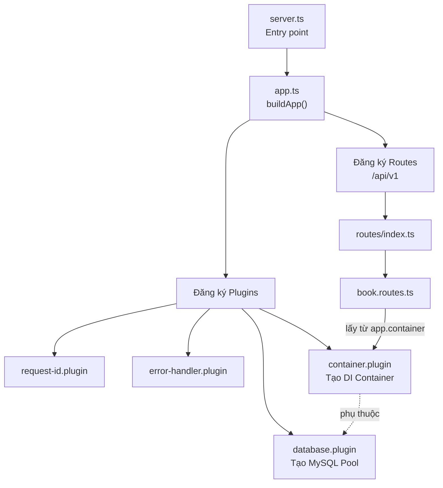
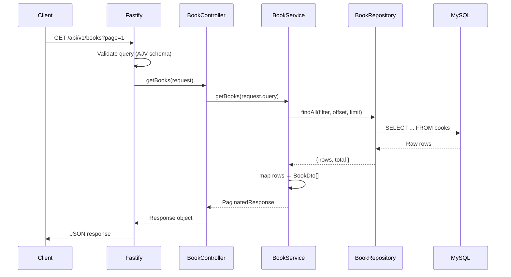
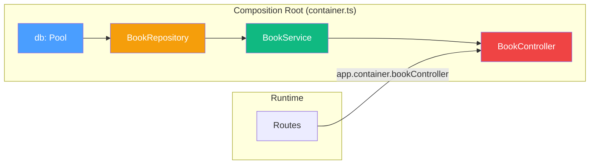

# Luồng chạy Project Books API

## Tổng quan kiến trúc



---

## Luồng khởi động (Startup Flow)

### Bước 1: Entry Point — [`server.ts`](file:///d:/Personal/Antigravity/books-api/src/server.ts)

```typescript
const app = buildApp();     // Tạo Fastify instance
await app.listen({ port: 3000, host: "0.0.0.0" });
```

File này chỉ làm 2 việc: gọi `buildApp()` để lấy Fastify app, rồi `listen()` để start server.

### Bước 2: Xây dựng App — [`app.ts`](file:///d:/Personal/Antigravity/books-api/src/app.ts)

`buildApp()` tạo Fastify instance và **đăng ký plugins theo thứ tự**:

| Thứ tự | Plugin | Nhiệm vụ |
|--------|--------|-----------|
| 1 | `requestIdPlugin` | Gắn request ID vào mỗi request |
| 2 | `errorHandlerPlugin` | Bắt lỗi và trả response chuẩn |
| 3 | `databasePlugin` | Tạo MySQL connection pool → gắn vào `app.db` |
| 4 | **`containerPlugin`** | Tạo DI container → gắn vào `app.container` |

Sau đó đăng ký routes với prefix `/api/v1`.

### Bước 3: Database Plugin — [`database.plugin.ts`](file:///d:/Personal/Antigravity/books-api/src/plugins/database.plugin.ts)

```typescript
const pool = mysql.createPool(poolConfig);   // Tạo connection pool
fastify.decorate("db", pool);                // Gắn pool vào app.db
```

Sau bước này, `app.db` có sẵn MySQL pool để dùng.

### Bước 4: Container Plugin (DI) — [`container.plugin.ts`](file:///d:/Personal/Antigravity/books-api/src/plugins/container.plugin.ts)

```typescript
// Khai báo dependency: phải chạy SAU database plugin
export default fp(containerPlugin, {
  name: "container",
  dependencies: ["database"],   // ← Fastify đảm bảo database plugin chạy trước
});
```

Plugin này gọi [`createContainer(app.db)`](file:///d:/Personal/Antigravity/books-api/src/container.ts) — đây là **Composition Root**:

```typescript
function createContainer(db: Pool): AppContainer {
  // 1. Tạo Repository (tầng truy cập DB)
  const bookRepository = createBookRepository(db);

  // 2. Tạo Service (tầng business logic), inject repository
  const bookService = new BookService(bookRepository);

  // 3. Tạo Controller (tầng xử lý HTTP), inject service
  const bookController = new BookController(bookService);

  return { bookController, bookService };
}
```

> [!IMPORTANT]
> **Tất cả object được tạo ở ĐÂY, một lần duy nhất.** Không có layer nào tự `new` dependency của mình.

### Bước 5: Route Registration — [`book.routes.ts`](file:///d:/Personal/Antigravity/books-api/src/modules/books/book.routes.ts)

```typescript
const bookRoutes: FastifyPluginAsync = async (app) => {
  // Lấy controller đã được tạo sẵn từ container
  const { bookController: controller } = app.container;

  app.get("/books", { schema: listBooksSchema }, controller.getBooks);
  app.get("/books/:id", { schema: getBookSchema }, controller.getBookById);
  // ...
};
```

Routes **không tạo bất kỳ object nào** — chỉ lấy từ container và map vào HTTP endpoints.

---

## Luồng xử lý Request (Runtime Flow)

Khi client gọi `GET /api/v1/books`:



### Chi tiết từng tầng:

| Tầng | File | Trách nhiệm |
|------|------|-------------|
| **Routes** | [`book.routes.ts`](file:///d:/Personal/Antigravity/books-api/src/modules/books/book.routes.ts) | Khai báo endpoint, schema validation |
| **Controller** | [`book.controller.ts`](file:///d:/Personal/Antigravity/books-api/src/modules/books/book.controller.ts) | Đọc request, gọi service, set HTTP status code |
| **Service** | [`book.service.ts`](file:///d:/Personal/Antigravity/books-api/src/modules/books/book.service.ts) | Business logic (validate ISBN, check loans, map DTO) |
| **Repository** | [`book.repository.ts`](file:///d:/Personal/Antigravity/books-api/src/modules/books/book.repository.ts) | Viết SQL, tương tác MySQL |

---

## Dependency Injection Flow



**Nguyên tắc:** Mỗi layer chỉ biết interface của layer bên dưới:
- `BookController` nhận `BookService` qua constructor — không biết service tạo ra sao
- `BookService` nhận `BookRepository` (interface) — không biết implementation dùng MySQL hay gì
- `BookRepository` nhận `Pool` — không biết pool config ra sao

> [!TIP]
> Khi viết test, ta chỉ cần mock interface `BookRepository` rồi inject vào `BookService` — không cần database thật. Đó là lý do 33 test cases trong [`book.service.test.ts`](file:///d:/Personal/Antigravity/books-api/tests/book.service.test.ts) chạy cực nhanh (25ms).
